# 武林助手（wlClient）完整使用说明书

> 适用版本：wlClient（包名 `com.lgns`）当前 master 分支
> 截图来源：Android 模拟器（1080×1920），涉及账号地址已做涂鸦屏蔽
> 文档更新时间：2026-11（含「统收盟福」与完整流程入菜单版本）

<span style="color:#D32F2F;font-weight:bold">截图数据只是模拟渲染效果，相关数据数值不作为真实展示，以个人私钥为准。</span>


---

## 目录

1. [功能总览：五大批量 + 完整流程](#1-功能总览五大批量--完整流程)
2. [安全与信任：开源、安装渠道与私钥保护**[除了携带方便,请给我用app的理由?]**](#2-安全与信任开源安装渠道与私钥保护)
3. [应用总览与主界面](#3-应用总览与主界面)
4. [准备工作：私钥与加密密码](#4-准备工作私钥与加密密码)
5. [基础数据管理：分组 / 支付方 / 接收方](#5-基础数据管理分组--支付方--接收方)
6. [批量充值（fLGNS 门票）](#6-批量充值flgns-门票)
7. [批量充值手续费（DAI）](#7-批量充值手续费dai)
8. [批量入场](#8-批量入场)
9. [批量领取（三类收益）](#9-批量领取三类收益)
10. [批量铸造盟主令与统收盟福](#10-批量铸造盟主令与统收盟福)
11. [完整流程（五段串联）](#11-完整流程五段串联)
12. [批量转账（收益分配）](#12-批量转账收益分配)
13. [系统配置详解](#13-系统配置详解)
14. [账号详情页](#14-账号详情页)
15. [锦标赛统计](#15-锦标赛统计)
16. [运行日志与结果核对](#16-运行日志与结果核对)
17. [链上验证方法](#17-链上验证方法)
18. [常见问题排查](#18-常见问题排查)
19. [安全注意事项](#19-安全注意事项)

---

## 1. 功能总览：五大批量 + 完整流程

武林助手是为「武林擂台」游戏运营者打造的**多账号批量作业客户端**（Anubis 链，链 ID 6714）。
所有资金操作由本机直接用每个账号自己的私钥签名上链，**全程无服务器中转、无云端代签**。

### 1.1 五大批量功能

| 功能 | 干什么 | 详见 |
|---|---|---|
| **批量充值** | 主号给全部启用账号补齐入场门票 **fLGNS**（差额式，只补不够的） | 第 6 章 |
| **批量入场** | 全部账号一键买票打圈（能打就打 / 等齐再打两种模式，每圈 24 座） | 第 8 章 |
| **批量领取** | 一键领回三类收益：甲子俸、师徒分成、擂台奖金 | 第 9 章 |
| **批量铸造** | 领讫满 60 天的甲子俸禄批量铸成**盟主令 NFT** 上链存证 | 第 10 章 |
| **统收盟福** | 批量领取持有盟主令逐期产生的**福泽奖励**（fLGNS，每号单笔 ≤8 枚） | 第 10.3 节 |

五大批量之外，还提供三项进阶能力：

- **完整流程**（第 11 章，入口已移到 ⋮ 菜单）：一个入口把上面五项串成一条流水线——
  充值 → 预检 → 入场 N 圈 → 领取 → 铸造 → 统收盟福，中途可随时停止，已发出的交易不回滚，
  收尾附带一份 ✓/✗/— 步骤总览；
- **批量充值手续费**（第 7 章）：给每个启用账号差额式补入**手续费币 DAI**——本链所有链上交易
  （入场/领取/铸造/转账）的手续费都按 ERC20 DAI 收取，原生币转账不可用；
  页内可按号单独编辑金额，已够的账号自动跳过不白转；
- **批量转账**（第 12 章）：把利润按配置**百分百（比例）或固定值（数额）**一次性分转给多个接收账号，
  支付方账本独立于账号库，fLGNS 与 DAI 双重校验通过才执行。

### 1.2 单个账号失败怎么办

批量作业中**任何单个账号失败都不会中断整批任务**：

1. 失败账号会在结果列表 / 运行日志中**逐条列明原因**（余额不足、预检不过、交易被拒等）；
2. 点击该失败账号进入**账号详情页**（第 14 章），可针对这一个账号**单独入场 / 单独领取 / 单独铸造 / 单独领取福泽（盟福）**，
   修好后再回到批量任务即可；
3. 历史失败记录在**日志管理页**（第 16 章）可随时回看、搜索、导出 CSV。

---

## 2. 安全与信任：开源、安装渠道与私钥保护(**除了携带方便,请给我用app的理由?**)

### 2.1 开源可审：不需要「相信开发者」

本应用**完全开源**：任何人（包括不信任我们的人）都可以拿到全部源码，逐行检查有没有
隐藏转账地址、偷偷上报数据、预留后门等「搞鬼」行为。加密相关代码（AES-256-GCM、
PBKDF2、salt/IV 生成）全部在本地仓库内可查，没有任何混淆模块。

**懂 Android 开发的开发者，推荐直接下载源码、自行编译并安装到自己的手机**——
自己编译出的 APK 不经过任何中间人之手，这是信任成本最低的方式。

### 2.2 为什么没有「一号代打」？

因为**一个账号被偷，全部家当就完蛋**。我们刻意不做任何「集中授权」设计：

- 没有「总钥匙」能代表其他账号签名，每笔交易都必须用**该账号自己的私钥**本地签名；
- 即使某个账号的私钥 / 密码不幸泄露，损失也**止于该账号**，不会连带其他账号；
- 主号也只负责充值出资，不参与入场；批量转账用的是独立的「支付方」账本，
  三套角色互不越权。

### 2.3 为什么没有自动升级？

自动升级 = 开发者可以随时把新代码塞进你的手机。即使今天的版本干净，
一旦升级通道被滥用或被劫持，明天的版本就可能植入第三方作恶代码（偷私钥、改转账地址）。
所以本应用**没有后台静默更新、没有自升级模块**：所有升级必须由用户本人主动完成，
升级前还可以先审源码再装（见 2.1）。

### 2.4 私钥保存安全吗？——看「加解密密码」强度说明

私钥以 **AES-256-GCM** 密文存在本机，密钥由加解密密码经 **PBKDF2-SHA256 六万五千余轮**派生，
每把私钥的 salt / IV 独立随机生成；密码本身**只在内存临时使用，退出 App 即清零，不落盘不留痕**。
真正的安全短板只剩一个：密码强度。在「添加私钥」弹框点密码输入框旁的 **❓ 图标**，
可直接查看 App 内置的离线爆破估算：

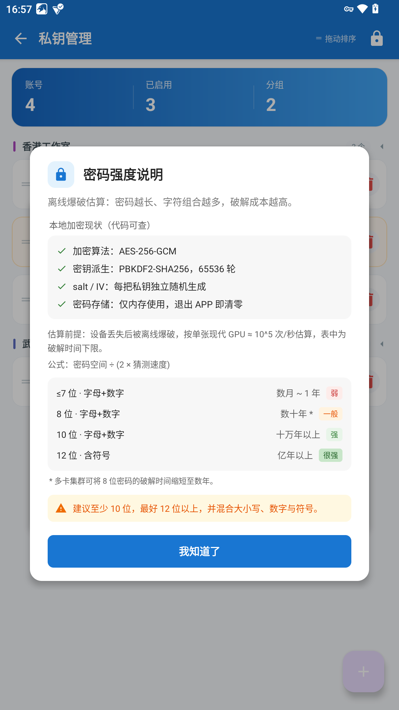

*图 2：密码强度说明页（添加私钥 / 私钥管理 / 安全提醒共用同一入口）。按单张现代 GPU
≈ 10^5 次/秒的离线爆破估算：≤7 位数月~1 年（弱）；8 位数十年（一般，多卡集群可缩至数年）；
10 位十万年以上（强）；12 位含符号亿年以上（很强）。建议至少 10 位，最好 12 位以上，
混合大小写、数字与符号。*

### 2.5 解密密码可能泄露的场景

| 泄露场景 | 风险 | 应对 |
|---|---|---|
| 输密码时被旁人**监控 / 肩窥** | 密码直接被看到 | 遮挡输入；泄露后尽快用「改密」功能全量重加密 |
| 被**偷拍**（录屏 / 摄像头） | 同上 | 同上；密码不要在其他设备明文保存 |
| 手机**维修 / 刷机** | 对方拿到密文，尝试离线爆破 | 维修前退出 App、关闭锁屏密码显示通知；**密码强度够则无需担心**：10 位以上密码在人类寿命内爆破不出来 |

需要强调：即使密文整库被拷走，攻击者也要先逐把爆破；而 App 使用密码时仅临时读取内存、
用完即清零，再三提醒「不得泄露加解密密码」**，不存在后台上报密码的通道（开源可验，见 2.1）。

### 2.6 丢失手机 / 平板怎么办？——利用破解窗口期转移财产

设备丢失 ≠ 私钥立即失守：手机有锁屏，私钥有 AES-256 密文，黑客必须先离线爆破加解密密码。
**窗口期长短完全由密码强度决定**（对照图 2：8 位密码窗口期数年，10 位以上窗口期实际上无限）。
发现丢失后应立即：

1. 用另一台可信设备登录链上钱包 / 本 App（凭记忆中的私钥备份），**把重点资产转移到新生成的安全地址**；
2. 若资产量大或密码短于 10 位，按「密码可能已泄露」处理：原地址只留少量过渡资金；
3. 新设备上重新导入私钥并设置 12 位以上强密码（新设备新密码，旧设备自然作废）。

### 2.7 安装渠道可信度对比（防偷私钥）

| 渠道 | 可信度 | 说明 |
|---|---|---|
| 自行克隆源码编译安装 | ★★★ 最高 | 代码完全经你之手，无任何中间人 |
| 官方项目的可信打包产物 | ★★ 高 | 支付少许服务器算力费用的官方发布渠道；下载后**对比签名与哈希校验**（见下） |
| 陌生网盘 / 论坛分享 / 第三方下载站 | ✩ 危 | 重打包植入偷钥代码的重灾区 |
| 「好友转发」的第三方镜像包 | ✩ 危 | 默认不可信：可能**当前不偷、静默升级后再偷**（而本 App 无自升级，被改出升级功能的必是伪包） |

**签名 / 哈希校验方法**：把下载的 APK 与你自行编译的产物（或官方公布的 SHA-256）比对哈希；
用 `apksigner verify --print-certs` 查看签名证书指纹是否与官方一致。对不上的一律不装。
链上资产的安全，从你装进手机的那一个安装包开始。

### 2.8 本 App 与 Windows 电脑同类程序的安全对比

| 对比项 | 本 App（开源、本地签名） | Windows 电脑区块链程序（常见形态） |
|---|---|---|
| 源码可审 | 完全开源，可自行编译安装（见 2.1） | 开源可审查或者闭源加壳无法审查 |
| 私钥存储 | AES-256-GCM 密文 + PBKDF2 六万五千余轮派生，每把 salt/IV 独立随机（见 2.4） | 普遍存在安装目录的配置文件 / 明文或者加密 JSON,电脑中招直接私钥上传服务器 |
| 签名位置 | 每笔交易用该号自己的私钥本机签名，无服务器中转、无云端代签（见 2.2） | 多为本地/中继签名 / 云端代签」，私钥或资产要审查不能经过第三方服务器 |
| 升级通道 | 无自升级，升级必须本人主动完成，可先审源码再装（见 2.3） | 黑客攻击windows电脑修改静默自动升级 ,极有可能更换你电脑上的代码 |
| 分发介质 | APK + 可验签名/哈希（见 2.7） | 压缩包附赠「激活工具」，是木马与假客户端重灾区 |
| 运行环境隔离 | Android 沙箱：应用之间互不可读，无法后台扫盘 | Windows 进程间可<u>**互读内存/文件**</u>，键盘记录、截屏成本低 |
| 泄露爆炸半径 | 单号私钥泄露损失止于该号（无总钥匙设计） | Windows 极易被攻击,「主密钥]被盗窃破解 |
| 设备丢失 | 锁屏 + 密文 + 自动清除策略，爆破窗口期可按密码强度估算（见 2.6） | 电脑被盗/中远控木马，明文或者密文 的密钥文件直接被拷走 |

结论：真正的差异不在「手机还是电脑」，而在**开源本地签名 、设备丢失 、无自升级  、 静默升级**。
选同类工具时，先拿表里前四项（源码、存储、签名、升级）逐条对照，就能过滤掉绝大多数偷钥风险。

> 日常使用层面的安全细则（备份、改密、网络环境等）见第 19 章。

---

## 3. 应用总览与主界面

武林助手是 Anubis 链（链 ID **6714**）上「武林擂台」游戏的批量操作客户端，
核心能力全部围绕**多账号批量作业**：充值、入场、领取、铸造、转账。

### 3.1 主界面构成

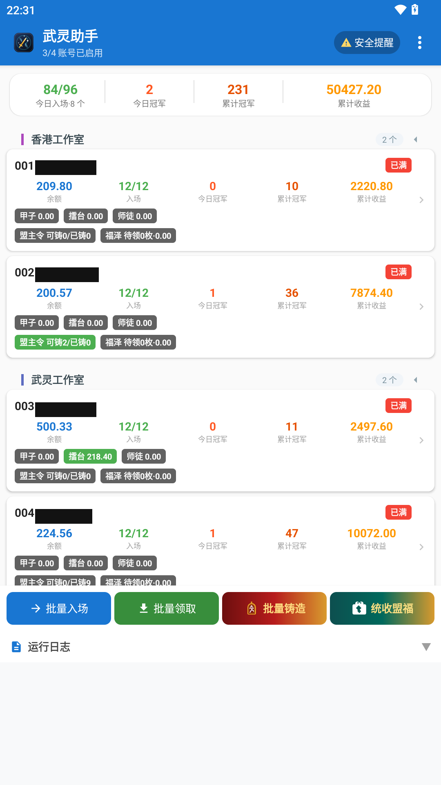

*图 1：主界面（新版实机渲染）。顶部统计栏（今日入场 84/96、今日冠军 2、累计冠军 231、累计收益 50427.20 fLGNS）；
中部账号列表按分组折叠展示，每行按两行排五个收益胶囊（第一行甲子/擂台/师徒，第二行盟主令/福泽，
如 002 号「盟主令 可铸2/已铸0」绿底提示有待铸）；
底部一排四个操作按钮：【批量入场】【批量领取】【批量铸造】【统收盟福】；
最下方是可展开的【运行日志】折叠区。*（图中数值为模拟渲染，非真实数据）

| 区域 | 说明 |
|---|---|
| 标题栏 | 应用名 + 启用账号数；右侧【安全提醒】按钮与 **⋮** 更多功能菜单 |
| 统计栏 | 今日入场（已入场/可入场）、今日冠军、累计冠军、累计收益 |
| 账号列表 | 按分组折叠；每行显示编号、地址（长按可复制）、余额、入场、今日冠军、累计冠军、累计收益，下方两行胶囊：甲子/擂台/师徒 + 盟主令/福泽 |
| 操作按钮 | 批量入场 / 批量领取 / 批量铸造 / 统收盟福，数据同步未完成时置灰；完整流程已移到 ⋮ 菜单 |
| 运行日志 | 实时滚动显示任务明细，点右侧 ▶ 展开 |

### 3.2 ⋮ 菜单总览

主界面右上角 **⋮** 打开功能菜单，共八个入口，其中「充值管理」「转账管理」是可展开分组（互斥展开）：

| 菜单项 | 去向 |
|---|---|
| 分组管理 | 分组增删改序页 |
| 私钥管理 | 账号私钥库 |
| 充值管理 ▶ | 批量充值（确认页）/ 批量充值手续费（页） |
| 转账管理 ▶ | 支付方管理 / 接收方管理 / 批量转账（页） |
| 日志管理 | 历史日志独立页（复制 / 导出 CSV） |
| **完整流程** | 五段串联流水线（见第 11 章），从底部按钮移入此处 |
| 锦标赛统计 | 全账号战绩统计页 |
| 系统配置 | 入场模式 / 连打场数 / 转账口径 / 自动清除 |

任务运行中菜单只放行**只读项**（日志管理、锦标赛统计）与**完整流程**，其余写入口自动置灰，防止并发抢 nonce。
「完整流程」不置灰是因为它是流水线运行期的**唯一停止出口**：自己正在跑时点它 = 安全点停止；
其它任务在跑时点它只弹提示，不会误停正在执行的任务。

### 3.3 收益口径

- **甲子 / 擂台 / 师徒** 三个胶囊显示该账号当前**可领额度**（fLGNS），领完归零；
- **盟主令 可铸X/已铸Y**：已铸 = 链上 `balanceOf`；可铸 = 领讫满 60 天的俸禄笔数 − 已铸；
  链上查询失败时胶囊隐藏，绝不显示伪造数字；
- **福泽 待领N枚·X**：本期状态为「待领」的盟主令枚数与对应 fLGNS 奖励合计（与官网同口径）；
  绿=有待领可收，灰=查过确实没有；查询失败同样隐藏不伪造；
- 所有金额单位：门票与收益为 **fLGNS**（ERC20），手续费为 **DAI**（ERC20，本链原生币转账不可用）。

---

## 4. 准备工作：私钥与加密密码

### 4.1 进入私钥管理

⋮ 菜单 → **私钥管理**。

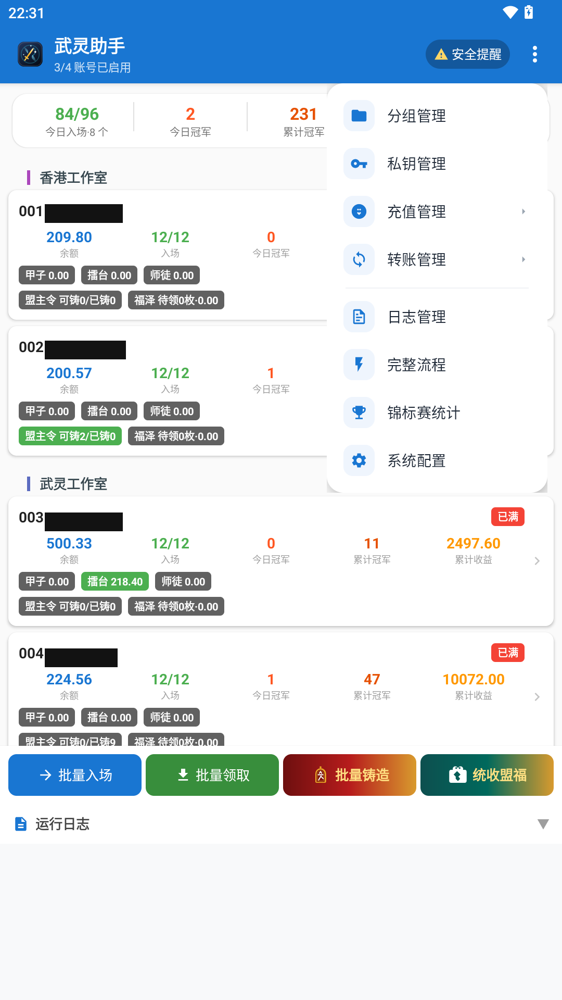

*图 3：⋮ 菜单展开态（八项入口，「完整流程」位于日志管理下方）。*

### 4.2 私钥管理页

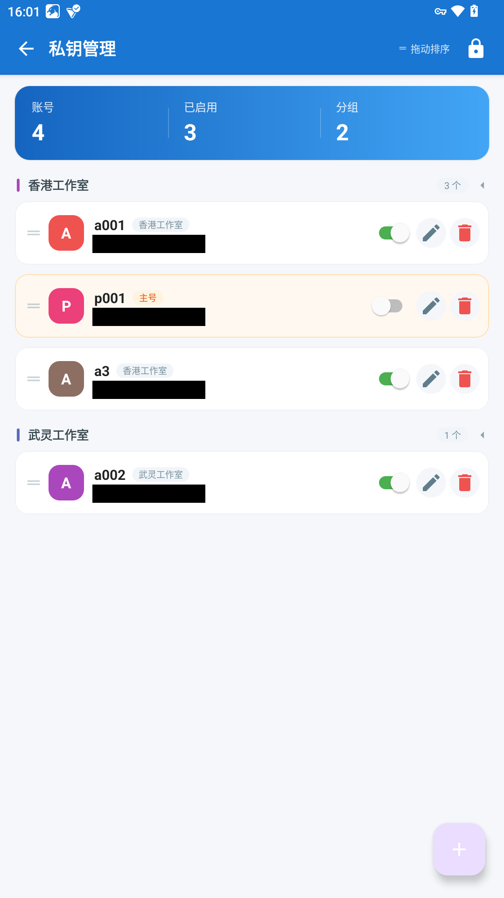

*图 4：私钥管理页。顶部摘要卡；每条私钥支持：启用/禁用开关、编辑（备注/分组/改密）、
删除、拖拽排序；主号带「主号」标记且默认禁用。地址已打码。*

要点：

- **只有「已启用」的私钥参与所有批量任务**（充值/入场/领取/铸造）；
- 主号（私钥管理页设置）是批量充值与批量充值手续费的**出资方**，平时保持禁用不参与入场；
- 转账用的是另一套「支付方」账本（见第 5 章），与私钥管理的主号互不影响。

### 4.3 添加私钥与「密码对标」规则（重要）

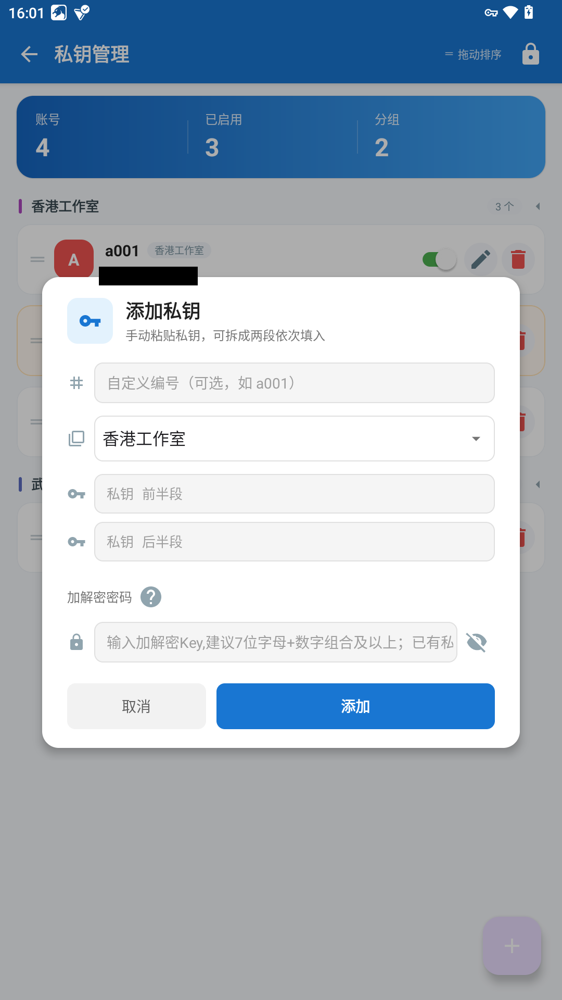

*图 5：添加私钥弹框。私钥拆成前/后半段两次填入（降低整串泄露风险），
加密密码输入框的提示语已注明「已有私钥时须与现有密码一致」。*

**加密密码对标机制**：

- 库里已有私钥时，新私钥的加密密码**必须与第一条私钥的密码一致**；
- App 用 AES-GCM 试解第一条私钥密文来校验：解不开即报错
  「加密密码与已有私钥不一致…」，**拒绝添加**；
- 这样保证库里所有私钥同一个密码——批量任务只需输入**一次**解密密码就能解开全部账号；
- 想整体换密码：用私钥「编辑」里的**改密**功能，它会全量重加密所有记录，对标关系自动保持。

---

## 5. 基础数据管理：分组 / 支付方 / 接收方

### 5.1 分组管理

⋮ → 分组管理：新建/改名/删除分组，拖拽排序；账号在私钥管理里挂分组。
分组只影响**列表展示与统计归类**，不改变任何链上数据；
批量任务默认作用于**全部启用账号**，与分组无关（主界面勾选后可只对选中账号执行）。

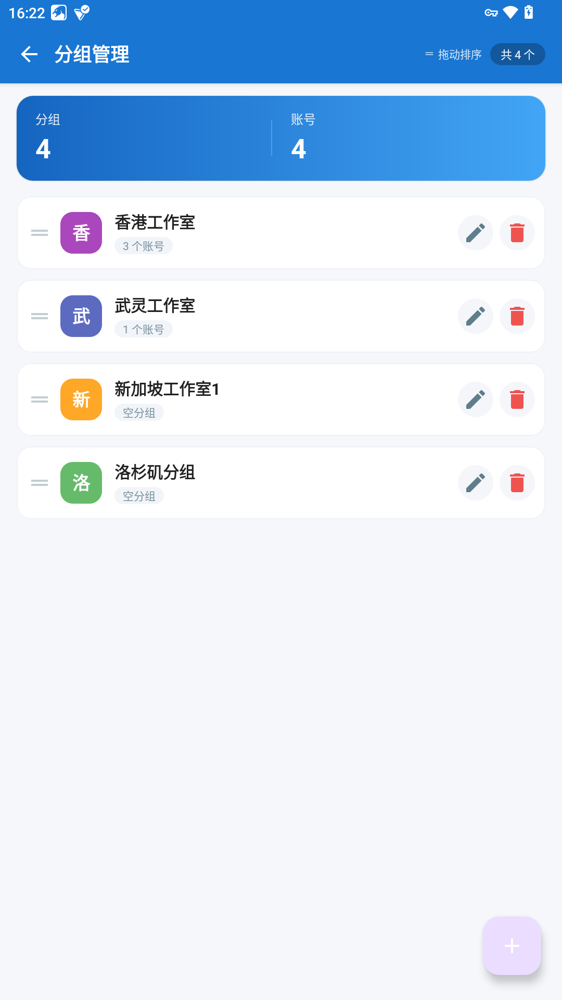

*图 6：分组管理页（本页无地址）。*

### 5.2 支付方管理（批量转账的出资账本）

⋮ → 转账管理 ▶ → 支付方管理。支付方是**独立于账号库的另一套账本**：
批量转账时从这里选一个「主支付方」作为转出方。

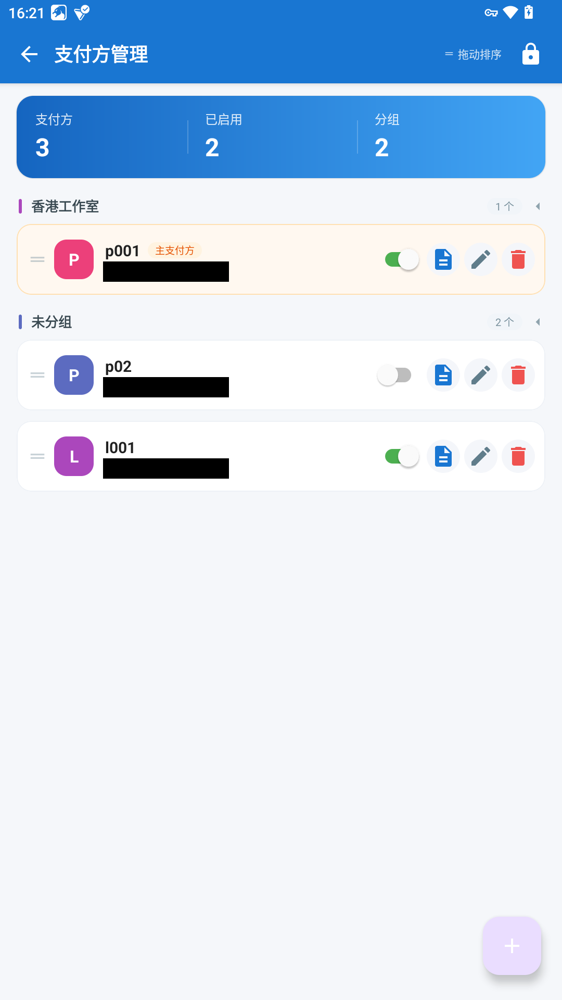

*图 7：支付方管理页。摘要卡（支付方 3、已启用 2、分组 2）；
p001 为「主支付方」（橙色高亮行）；每条支持启用开关、查看交易记录、编辑、删除、拖拽排序。地址已打码。*

### 5.3 接收方管理（批量转账的收款账本）

⋮ → 转账管理 ▶ → 接收方管理。接收方是收益分配的目标名单，
每行维护两个分配字段：**收益比例（%）** 与 **收益数额（fLGNS）**，
两者分别对应「按比例 / 按数额」两种转账口径（见第 12 章）。

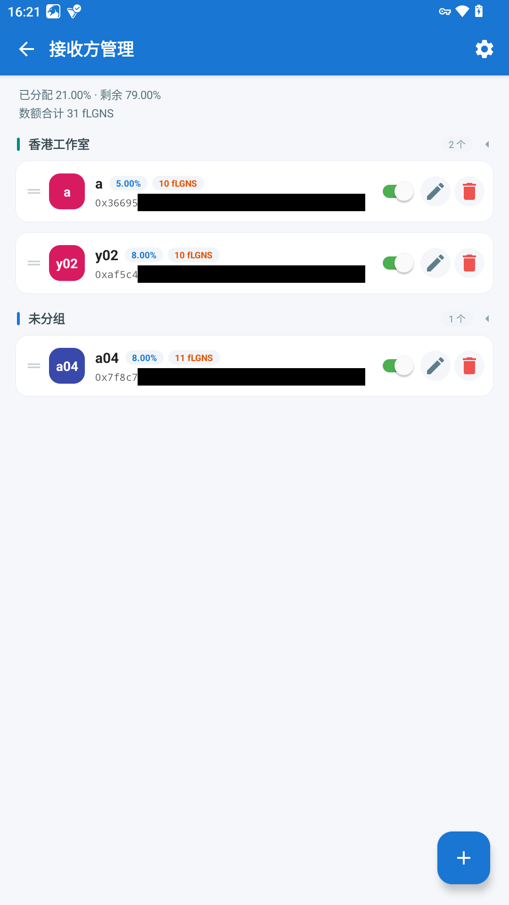

*图 8：接收方管理页。按分组折叠，每行显示编号、比例与数额；接收地址已打码（保留前缀、遮盖后续）。*

---

## 6. 批量充值（fLGNS 门票）

**用途**：由私钥管理的主号给其余启用账号补齐**入场门票 fLGNS**（单席门票 100 fLGNS）。
入口：⋮ → 充值管理 ▶ → **批量充值**。

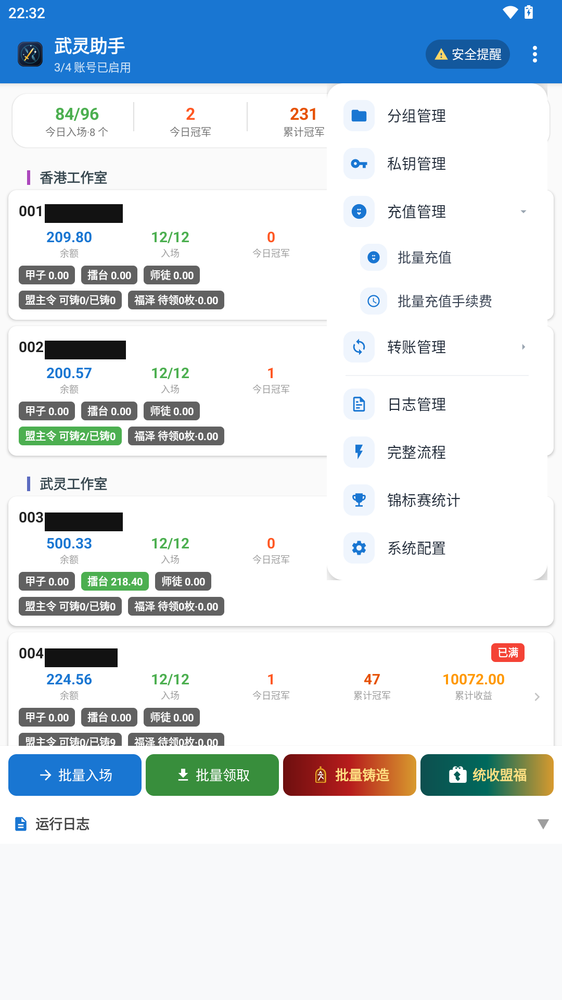

*图 9：充值管理分组展开（含「批量充值」「批量充值手续费」两项）。*

### 6.1 确认页（先算账，再花钱）

点击「批量充值」后进入全屏确认页，**不发任何交易**，先把账算清楚：

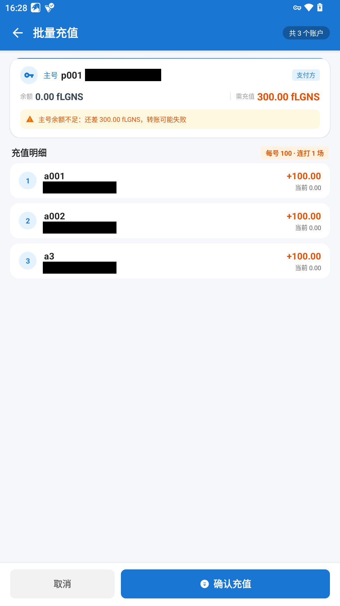

*图 10：批量充值确认页。顶部主号卡（余额 / 需充值合计 / 余额不足橙色警告），
下方逐账号列出「+100.00 当前 0.00」的差额明细；右上角标注分配口径
「每号 100 · 连打 1 场」；底部【取消】【确认充值】。地址已打码。*

**充值目标不是固定 100**：目标 = 连打场数 × 100 fLGNS（见系统配置），
多补的部分是**预留冠军轮空的门票**——冠军拿的是锁仓甲子不是现金，
只补 100 会让冠军号下一圈买不起票，导致那一轮凑不满 24 座被整体取消。

### 6.2 执行

1. 核对差额无误后点【确认充值】→ 输入解密密码；
2. 主号逐笔 `transfer` 补差额：每笔转账前**重新读一次余额**，已够自动跳过；
3. 单笔失败只记日志，不影响其余账号；
4. 中途按【停止】：当前这笔发完后中断，已发出的交易不回滚。

> 完整流程内的自动充值走同一套差额逻辑，但**没有确认页**（密码只输一次）。

---

## 7. 批量充值手续费（DAI）

**用途**：给每个启用账号补**手续费币 DAI**——本链所有交易（入场/领取/铸造/转账）
的手续费都按 ERC20 DAI 收取，原生币转账不可用。
入口：⋮ → 充值管理 ▶ → 批量充值手续费。

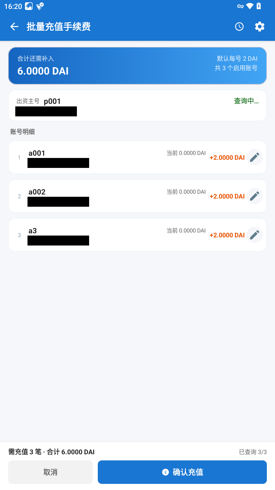

*图 11：批量充值手续费页。顶部合计卡（合计还需补入 6.0000 DAI、默认每号 2 DAI）；
出资主号卡；账号明细每行可**单独编辑金额**（铅笔图标），右侧实时显示
「当前 x DAI / +y DAI」；底部合计栏 + 【取消】【确认充值】。地址已打码。*

要点：

- **差额式补入**：目标值是用户填的，实际只转「目标 − 当前余额」，已够的账号跳过；
- 默认金额可在页内设置图标里改全局默认（出厂 2 DAI/号）；
- 主号除了付出补入额，还要预留自己这几笔 transfer 的手续费，余额判断一并计入；
- 余额查询失败的行**不会当成 0 余额**继续补（防止多发），标红提示后跳过。

---

## 8. 批量入场

**用途**：把启用账号送进擂台下注对局。入口：主界面底部【批量入场】。


*图 12：批量入场前的解密密码弹框（所有会发交易的按钮都是这个统一弹框，
图中背景为打码后的主界面）。点「密码说明」可查看规则；点【取消】不发生任何链上操作。*

### 8.1 两种入场模式（系统配置里选）

| 模式 | 行为 | 适用 |
|---|---|---|
| **能打就打** | 每个账号各自立即入座，不等别人 | 速度优先，尽快占座 |
| **等齐再打** | 先整批模拟校验（`previewEnter`），全部通过才真实提交 | 集中结算对账，避免只进场一半 |

### 8.2 执行规则

- 每轮 **24 个座位**；一笔入场可能顺带结算多轮已封盘的对局（gas 消耗因此波动）；
- 门票支付顺序由合约决定：账号的**奖金余额够 100 时先扣奖金**，不够才扣钱包 fLGNS；
- 首次入场会做一次 ERC20 **无限授权**（approve），之后不再重复授权；
- **连打场数**由系统配置决定（1~12，默认 1）：一次点击可连打多圈，
  圈与圈之间自动等待封盘（最多 6 分钟；座位数 2 分钟无增长判定补不满提前收尾）；
- **可续跑**：每账号的交易状态落盘，中途退出/崩溃后重会先回查已发出交易的回执，
  **重复点击不会重复入场**；
- revert 属确定性失败（条件不满足），**冷却 10 分钟**内不再对同一账号重发；
- 长时间 pending 只告警不重发，防止同 nonce 双花假象。

### 8.3 与充值的关系

批量入场**不再自动充值**（旧版会先查主号余额顺手补票，流程混乱已移除）。
正确姿势：先【批量充值】+【批量充值手续费】把弹药备足，再【批量入场】；
或者直接用 ⋮ 菜单里的【完整流程】一键串联。

---

## 9. 批量领取（三类收益）

**用途**：对启用账号逐个领取三类收益。入口：主界面底部【批量领取】。

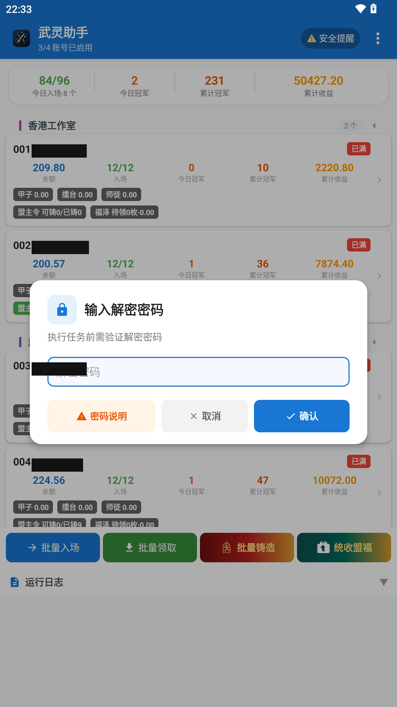

*图 13：批量领取前的解密密码弹框（与入场/铸造同一控件，背景地址已打码）。*

| 收益 | 内容 | 关键规则 |
|---|---|---|
| **甲子俸** | 夺冠后逐日释放的俸禄（fLGNS） | 单笔最多领 64 条记录（合约硬上限），序号多的账号自动分多笔领完 |
| **师徒分成** | 师承加成收益 | 按**今日场次**线性解锁：每场 10%，打满 10 场才 100%；当天不补齐，那份到 D+2 被合约**烧毁** |
| **擂台奖金** | 对局冠军奖金 | 随封盘结算进入可领额度 |

要点：

- **入场失败的号不跳过领取**——失败号反而更该把待领的钱收回来；
- 三类额度都查不出待领时跳过该号，不白烧手续费；
- 「领了满 60 天的甲子俸」就是**盟主令的可铸来源**（见下一章）；
- 日志里金额以 DAI/fLGNS 可读单位显示，revert 冷却、nonce 对齐等保护与入场同一套。

---

## 10. 批量铸造盟主令与统收盟福

**盟主令**（链上名称 *FUN LONGINUS Champion Mandate*，代号 MANDATE）是武林擂台的
链上收藏品，标准 **ERC-721 NFT**，独立部署在 Anubis 链：

| 项目 | 值 |
|---|---|
| 盟主令合约地址 | `0xfffe850fd170625a8f816a731b9b278cc161aaaa` |
| 擂台主合约地址 | `0xff060bAB41e16eBF0eFE4FAd454404Fd5f75aAaA` |
| 部署时间 | 2026-11-05 06:07（+08:00），区块 18295322 |
| RPC 节点 | `rpc.anubispace.org` / `rpc1` / `rpc2`（App 自动轮换容错） |

**铸造规则（链上硬约束）**：

- 每一笔**已全部领讫**的俸禄（甲子记录，累计领取满 60 天）可以铸造 **1 枚**盟主令；
- 铸造由盟主令合约**链上实时校验**主合约的俸禄状态——未领讫、或该笔已铸过的，
  合约直接拒绝（字节码硬编码主合约地址，校验无法绕过）；
- 刚领完俸禄**不会立刻**多出一枚可铸：俸禄需逐日成熟满 60 天才进入可铸清单。

### 10.1 批量铸造步骤

入口：主界面底部【批量铸造】（绛红→鎏金渐变按钮）。


*图 14：铸造前的解密密码弹框（与入场/领取同一控件）。*

输入正确密码后，对每个启用账号依次执行：

1. **查可铸清单**：链上读取领讫满 60 天且 `used(index)==false` 的俸禄 index 列表；
   - 查询失败 → **该账号不发任何交易**（宁可跳过，绝不基于旧数据铸重）；
   - 清单为空 → 日志提示「无可铸盟主令（领讫俸禄已全部铸造），跳过」；
2. **分批铸造**：单批上限 **24 枚**（对齐官网前端；合约硬上限 64，但 64 枚一笔约
   12.25M gas 会超区块限制被拒），可铸超过 24 枚的账号在同一次任务内**连续拆批**；
3. **逐批发送** `mint(uint256[])` 交易，每批确认成功后再发下一批。

### 10.2 停止与重跑

- 任务中按钮变【停止】，点击后在当前批完成后的安全点退出；
- 铸造天然**幂等**：已铸 index 被 `used()` 过滤，中断后直接重跑即可续铸；
- revert 类失败不重试，该账号跳过、任务继续。

### 10.3 统收盟福（批量领取福泽）

**福泽（江湖福泽）**是盟主令 NFT 的持有收益：合约按固定周期（每期 6 天）给每个
持有盟主令的账号计提 fLGNS 奖励，官网同口径展示为「待领 N 枚 · X fLGNS」。
入口：主界面底部【统收盟福】（批量铸造右侧，礼盒图标）。

| 项目 | 值 / 规则 |
|---|---|
| 福泽合约地址 | `0xff1e7170c041c0e37bf9b9ce0feed600f3deaaaa`（独立于主合约与盟主令合约） |
| 期数算法 | 第 1 期到 `claimDeadline` 截止；之后每 6 天（518400 秒）一期 |
| 可领条件 | 只有本期状态为「待领」（status=2）的枚数进领取清单 |
| 单笔上限 | 每号单笔交易最多 **8 枚**（超出的同次任务内自动拆多笔） |
| 截止提醒 | 每期奖励在领取截止后不再补发，详情页可查看本期截止时间 |

执行流程与批量领取同一套保护：一次密码输入 → 逐号链上查待领清单 →
查询失败**不发交易**（宁可跳过不伪造）→ 清单为空跳过不白烧 gas →
revert 不重试、单号失败不断批。中断后直接重跑即可续领（已领枚数状态会变，天然幂等）。

> 单号补领：账号详情页【铸造】后面的【盟福】按钮，同逻辑只作这一个号，
> 单笔 ≤8 枚，超出时日志提示「还剩 Y 枚，请再点一次」。

---

## 11. 完整流程（五段串联）

**用途**：一次密码验证，串起 **充值 → 入场 → 领取 → 铸造 → 统收盟福** 全天作业。
入口：⋮ 菜单 → **完整流程**（原主界面底部按钮已移除，让位给【统收盟福】）。


*图 15：完整流程的解密密码弹框（从 ⋮ 菜单触发，输一次密码，五个阶段共用；点【取消】不发生任何链上操作）。*

### 11.1 执行序列

```
第1步 批量充值(自动)  →  等待5秒节点同步
预检                  →  第2步 批量入场(连打 N 圈)  →  等待5秒
第3步 批量领取        →  第4步 批量铸造盟主令  →  第5步 统收盟福
```

- **充值目标**按连打圈数计算（圈数 × 100 fLGNS，预留冠军轮空门票）；
- **预检**在充值落地后进行（这时读到的余额才是真实值），检查三件事：
  ① 今日剩余场次（打满 12 场直接跳过入场，不再空跑）；
  ② 每个号的 DAI 够不够打（充值只补 fLGNS **完全不碰 DAI**，一个号发不出交易
  整轮就凑不满 24 座、后续圈全部作废——木桶效应，取最差账号定圈数）；
  ③ 账号数是否为 24 的整数倍（只提示不拦截）；
- **领取阶段**顺带触发最后一轮的结算（合约每次最多自动结算若干轮）；
- **铸造紧跟领取无需等待**：本轮新领俸禄未满 60 天不会进可铸清单，安全；
- **统收盟福收尾**：铸完的盟主令本期还不产生福泽，但历史持有枚数的待领福泽
  在这一步一并收齐（每号单笔 ≤8 枚，同次任务内自动拆批）。

### 11.2 停止语义（重要）

运行中再点 ⋮ → 完整流程即触发停止（已发出的交易不回滚）：

| 按停止的时机 | 行为 |
|---|---|
| 充值阶段 | 当前这笔转完即停，**跳过入场**，但领取/铸造/统收盟福照常执行 |
| 入场阶段 | 停在**圈边界**（已打的圈都封盘结算后停），剩余圈不打，领取/铸造/统收盟福照常 |
| 领取/铸造/统收盟福阶段 | 当前这笔完成后跳出后续步骤 |

之所以「停也要领」：甲子俸、师徒分成与福泽奖励**不领就会进烧毁队列或过期**，
任何停止方式都不该把钱留在场上。

### 11.3 步骤总览（✓ / ✗ / —）

任务收尾时运行日志固定输出一份对标大厂风格的分步清单，每步一行：

```text
完整流程步骤总览
✓ 批量充值
✓ 批量入场 · 共 3 圈
✗ 批量领取 · 成功=18 跳过=2 失败=4
— 批量铸造
— 统收盟福
```

| 符号 | 含义 |
|---|---|
| ✓ | 该步正常跑完（按圈停止后的收尾也算正常） |
| ✗ | 该步被硬取消或异常中断 |
| — | 该步未执行（前序中断或被跳过） |

行尾数字直接取自各子任务的汇总行，不另起一套统计，与单独跑同名批量任务的日志完全一致；
子任务本身无数字尾缀的步骤（如充值）只打符号与名称，不硬造数据。

### 11.4 连打场数怎么设

系统配置 → 连打场数（1~12，默认 1）：

- 想拿满师徒分成解锁比例（100%）至少要打 **10 场**（满勤线）；
- 11/12 圈结构性收益不再增加，但每场仍是独立抽奖、师承加成逐席继续计提；
- 圈数在任务启动时**快照**，中途改配置不影响正在跑的任务。

---

## 12. 批量转账（收益分配）

**用途**：把「支付方」主号的 fLGNS 余额按预设口径分给「接收方」名单——
适合把批量作业产出归集到工作室/股东地址。
入口：⋮ → 转账管理 ▶ → 批量转账。

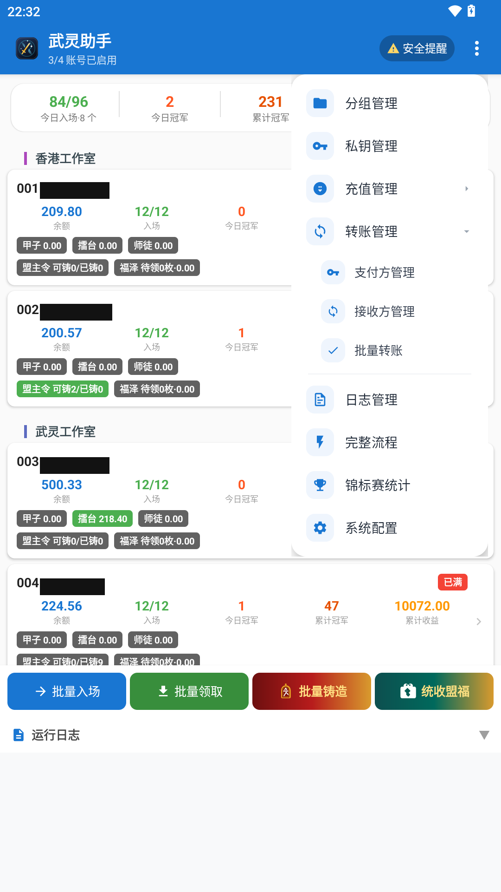

*图 16：转账管理分组展开（支付方管理 / 接收方管理 / 批量转账三项）。*

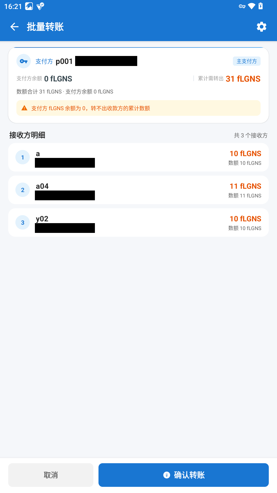

*图 17：批量转账确认页。顶部支付方卡（余额 / 累计需转出 / 余额不足警告），
下方接收方明细逐行显示应转数额；底部【取消】【确认转账】。地址已打码。*

### 12.1 两种分配口径（系统配置里选）

| 口径 | 依据 | 说明 |
|---|---|---|
| **按收益比例** | 接收方每行的百分比 | 把支付方可分配余额当 100% 拆开；舍入尾差由最后一笔兜底 |
| **按收益数额** | 接收方每行填的 fLGNS 枚数 | 每行固定拿指定枚数，不依赖余额；合计超出余额则整批拦下 |

### 12.2 执行规则

- 转账前**双重校验**：fLGNS 够分本次合计、DAI 够付全部转账手续费，
  任一不足**整体不动手**（避免转到一半断供）；
- 执行时逐笔记账，**单笔失败不重试不中断**，最后一并汇报成功/失败笔数；
- 确认页只是预览，点【确认转账】后仍需输入支付方私钥的解密密码。

---

## 13. 系统配置详解

入口：⋮ → 系统配置。

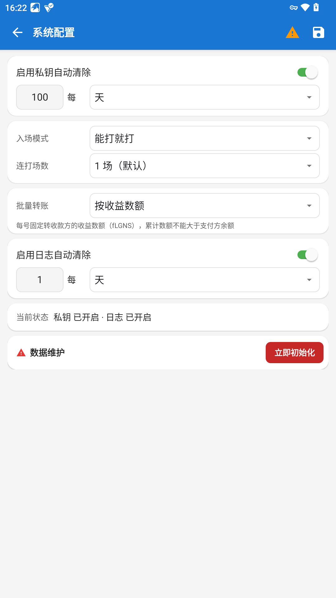

*图 18：系统配置页。*

| 配置项 | 取值 | 影响 |
|---|---|---|
| 启用私钥自动清除 | 天数（示例 100 天） | 超期未使用的私钥自动删除，设备丢失时的最后防线 |
| 入场模式 | 能打就打 / 等齐再打 | 批量入场与完整流程的入场策略（见 8.1） |
| 连打场数 | 1~12（默认 1） | 批量入场/完整流程一次跑几圈；充值目标随之变化 |
| 批量转账 | 按收益比例 / 按收益数额 | 批量转账的分配口径（见 12.1） |
| 启用日志自动清除 | 天数（示例 1 天） | 历史日志保留期，超期自动清库 |
| 立即初始化 | 按钮 | 重置本地运行状态（含入场续跑进度） |

---

## 14. 账号详情页

主界面点击任意账号行进入。既是**单号操作台**（顶栏【入场】【领取】【铸造】【盟福】
四个单号按钮，同样需要解密密码），也是**全量数据核对页**。

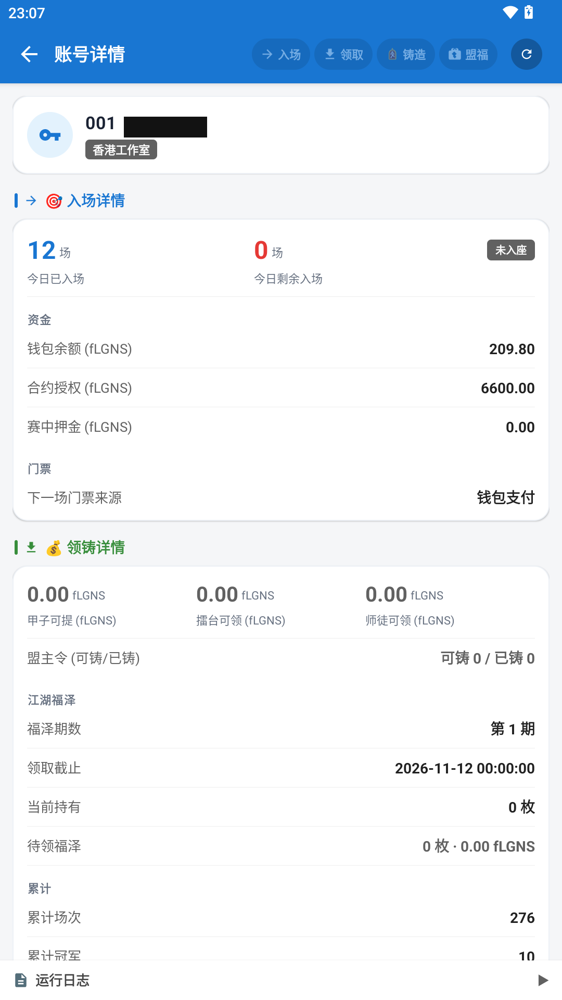

*图 19：账号详情页（001 号，新版实机渲染）。顶栏四个单号按钮【入场】【领取】【铸造】【盟福】；入场详情：今日已入场 12 场 / 剩余 0 场、钱包余额 209.80 fLGNS、
合约授权 6600.00 fLGNS、赛中押金 0.00、下一场门票来源「钱包支付」；
领铸详情：甲子可提 / 擂台可领 / 师徒可领、盟主令（可铸 0 / 已铸 0）、
**江湖福泽（福泽期数「第 1 期」/ 领取截止 2026-11-12 00:00:00 / 当前持有 0 枚 / 待领福泽 0 枚·0.00 fLGNS）**、
累计场次 276、累计冠军 10。地址已用黑条涂鸦遮盖，数值为模拟渲染。*

- 数据为进入页面时实时链上读取，右上刷新按钮可重拉；
- 单号【铸造】适合：① 只铸某一个号；② 批量任务后单独核对并补铸；
- 单号【盟福】领取本号本期待领福泽：单笔 ≤8 枚，待领超出时日志提示
  「还剩 Y 枚，请再点一次」，重复点击即可续领。

---

## 15. 锦标赛统计

⋮ → 锦标赛统计：全部账号的**只读**战绩页（任务运行中也可查看），
顶部全局合计（总场次 / 冠军次数 / 胜率），下方按分组折叠展示每号战绩，
拿过冠军的账号带绿色「冠军」徽标。

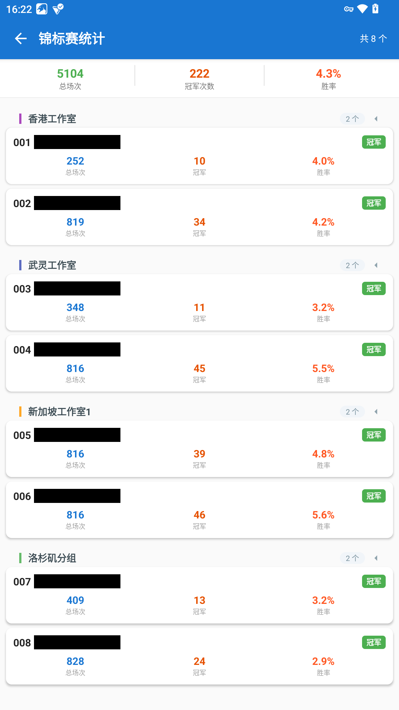

*图 20：锦标赛统计页（8 号账号，总场次 5104、冠军 222、胜率 4.3%）。地址已打码。*

---

## 16. 运行日志与结果核对

- **主界面运行日志**：底部折叠区实时滚动显示每账号的处理明细
  （查询结果、交易哈希、确认状态、失败原因），任务运行时自动展开；
- **日志管理**（⋮ 菜单）：独立页面查看全部历史日志，支持复制与导出 CSV，
  方便按交易哈希去浏览器逐笔对账；
- 日志受「日志自动清除」策略管理（见第 13 章），需要归档请及时导出。

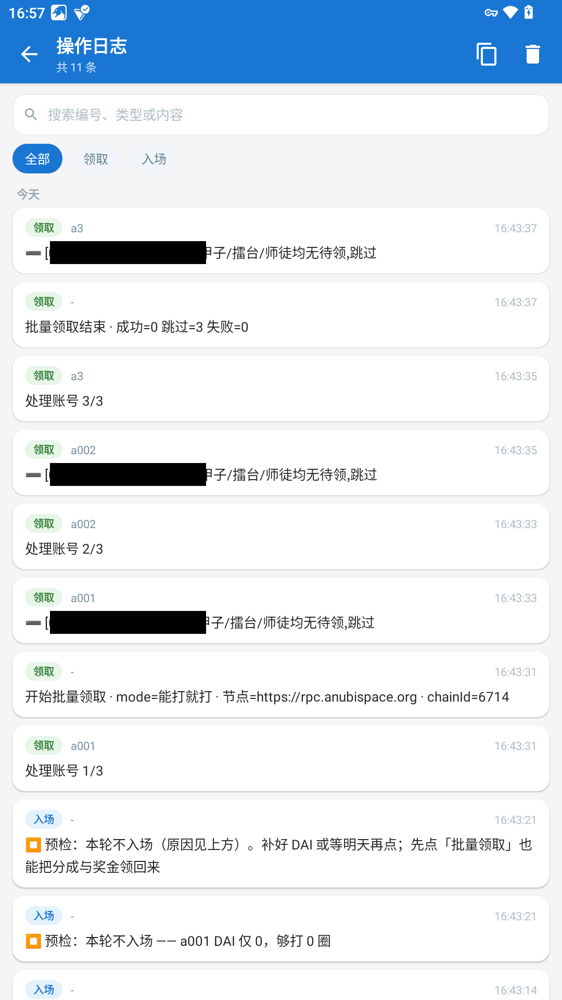

*图 21：日志管理页（实跑数据：共 11 条日志，含批量领取开始/进度/结束、逐账号链上查询结果、
入场预检拦截提示；日志中的账号地址已用黑条屏蔽）。*

---

## 17. 链上验证方法

### 17.1 区块链浏览器

打开 **https://browser.anubispace.org**：

| 想看什么 | 操作 |
|---|---|
| 某账号的某类交易 | 搜索账号地址 → Transactions 标签按 Method 过滤（`mint`/`transfer`/`enterArena` 等） |
| 合约整体活跃度 | 搜索合约地址 → Details（交易总数、部署交易、部署时间） |
| 每笔 mint 的 index 参数 | 交易详情 → Input Data，开头 `0xf8e93ef9`，后续每 64 个 hex 字符一个 index |
| 交易失败原因 | Status=Failed 的记录看 Revert Reason 与 Gas Used（100% 即 gas 不足） |

> 注意：盟主令合约源码**未验证**，浏览器没有 Read Contract 面板，且 Token transfers
> 索引可能为空——这不代表链上没有转账，读值请走下面的 eth_call。

### 17.2 Postman / curl 直查（自制 Read Contract）

POST `https://rpc.anubispace.org`，`Content-Type: application/json`，Body 示例：

**已铸数量（balanceOf）**——把 `地址40hex` 换成小写不带 0x 的地址：

```json
{ "jsonrpc": "2.0", "id": 1, "method": "eth_call", "params": [{
    "to": "0xfffe850fd170625a8f816a731b9b278cc161aaaa",
    "data": "0x70a08231000000000000000000000000地址40hex" }, "latest"] }
```

**某笔俸禄是否已铸（used(地址, index)）**——index 如 5 补零到 64 位：

```json
{ "jsonrpc": "2.0", "id": 1, "method": "eth_call", "params": [{
    "to": "0xfffe850fd170625a8f816a731b9b278cc161aaaa",
    "data": "0xad04dc3f000000000000000000000000地址40hex0000000000000000000000000000000000000000000000000000000000000005" }, "latest"] }
```

selector 速查：`70a08231`=balanceOf、`ad04dc3f`=used、`f8e93ef9`=mint、`18160ddd`=totalSupply。

**福泽（江湖福泽）查询**——对独立福泽合约 `0xff1e7170c041c0e37bf9b9ce0feed600f3deaaaa`：

| selector | 接口 | 用途 |
|---|---|---|
| `a32093c0` | `claimDeadline(uint256)` | 第 N 期领取截止时间（第 1 期用于推算期数基准，每期 6 天） |
| `a4d80086` | `periodInfo()` | 当前期信息 |
| `7d2fad23` | `ownedPage(address,uint256)` | 分页读该号持有的盟主令 id |
| `3bf2a83e` | `rewardOf(uint256)` | 单枚盟主令本期奖励与状态（status=2 为待领） |
| `b1b66652` | `claim(uint256,uint256[])` | 领取第 N 期指定枚（App 内单笔 ≤8 枚） |

**判读**：返回 `0x` = 合法空数据（不是节点坏了）；返回 `execution reverted` = 请求构造或状态问题。

---

## 18. 常见问题排查

| 现象 | 原因 | 处理 |
|---|---|---|
| 任何批量按钮报「加密密码与已有私钥不一致」 | 输入的解密密码与第一条私钥的加密密码不符 | 用添加私钥时设置的密码；忘了就用改密功能以旧密码为基准整体重置 |
| 批量入场大量「跳过」 | 门票 fLGNS 或手续费 DAI 不足 | 先【批量充值】补票、【批量充值手续费】补 DAI，再入场 |
| 入场那一轮迟迟封不了盘 | 有账号发不出交易，24 座凑不满 | 用预检日志定位掉队账号；或改用「能打就打」模式 |
| 师徒分成只领了一部分 | 今日场次不满 10 场，按比例解锁 | 日志会注明「今日入场 x/10 仅解锁 y%」；当天补齐场次，否则 D+2 烧毁 |
| 领取日志出现 OOG | 俸禄条数多、单笔 gas 上限被吃光 | App 已按页 64 条拆分；仍出现时反馈日志供升级 gas 配置 |
| 日志显示「无可铸盟主令」 | 领讫俸禄已全部铸造（可铸=0 属正常） | 无需处理；俸禄需逐日成熟满 60 天才新增可铸 |
| 日志显示「可铸俸禄查询失败，未发交易」 | RPC 节点抖动 | 稍后重跑即可，幂等安全 |
| 统收盟福日志「无待领福泽，未发交易」 | 本期没有 status=待领 的盟主令（刚铸的不计、或已领过） | 正常跳过；详情页「福泽期数/待领」行可核对 |
| 盟福只领了一部分 | 单笔合约上限 8 枚 | 按日志提示再点一次【盟福】续领，幂等安全 |
| mint 交易 revert | 链上校验不过（俸禄未满 60 天 / 已铸 / 清单过期） | 不重试；刷新数据后重跑，App 会重新拉取最新清单 |
| 批量转账提示「支付方余额为 0」 | 支付方账本里没收到收益 | 先把收益领进支付方地址（或改用账号库主号做支付方），再转账 |
| 转账部分失败 | 单笔失败不重试（防重复转出） | 按日志中的失败行单独补转；余额与 DAI 手续费都要复核 |
| 数字没变化/像是没领到 | 界面缓存未刷新 | 下拉刷新或重进 App；详情页点刷新按钮 |
| 交易一直未确认 | Gas 优先费过低或节点拥堵 | 浏览器查交易状态；Anubis 链 Base fee 为 0，优先费 10~20 Gwei 即可秒级确认 |
| 部分账号被整体跳过 | 私钥被禁用，或密码不一致解不开 | 检查私钥管理页开关状态与密码对标 |

---

## 19. 安全注意事项

1. **私钥存储**：私钥以 AES-256-GCM 加密存放于应用私有 SQLite，密码派生密钥不落地；
   解密后的私钥仅存在于任务运行期的内存中，任务结束即清零。
2. **密码对标**：全库统一密码是批量任务可用性的前提，请勿为不同私钥设置不同密码
   （App 已在添加环节强制拦截）。
3. **资金隔离**：账号库主号（充值出资）与支付方账本（转账出资）是两套独立账本，
   分别管理、分别授权，误操作影响面更小。
4. **截图与日志分享**：地址虽非机密，但配合金额可定位账号资产；对外分享截图前
   请像本文档一样对地址打码。日志导出 CSV 不含私钥与密码，可安全归档。
5. **自动清除**：系统配置可开启私钥/日志定时自动清除，设备丢失时最后一道防线。
6. **合约地址核对**：本文档合约地址与 `ArenaConfig.java` 一致；若项目方升级换址，
   以官网 funverse.gg 前端配置为准，勿轻信第三方渠道给出的地址。

---

## 附录：截图打码说明

本文档全部界面截图截自本地 Android 模拟器，凡涉及账号地址处均以黑色涂鸦条整段遮盖
（界面本身显示的是截断地址，截图上再整段封黑，不保留任何 hex 片段），
完整地址未在任何图片、日志或文档中出现。
截图时模拟器内为演示数据，与任何真实资产无关；**截图中的一切数值均为模拟渲染，
实际数据以个人私钥导入后的链上读取为准**。

> **截图更新记录**：全部界面截图（含主界面/菜单类的图 1、3、9、12、13、14、15、16 与详情页图 19）
> 已于 2026-11 用新版 App 重截，并对含地址处统一加了黑色涂鸦遮盖。
